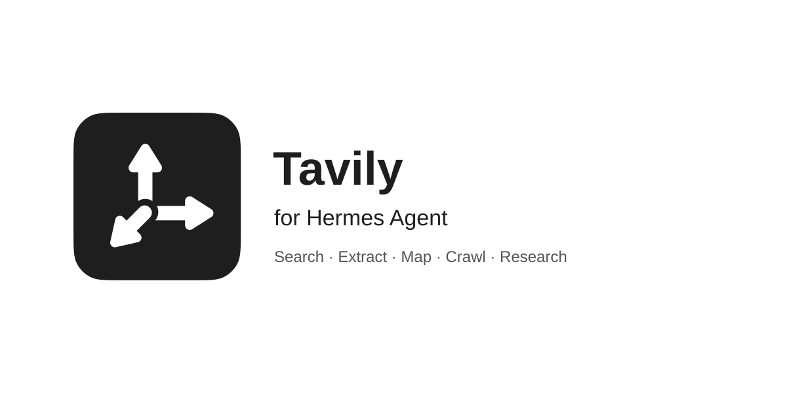

# Tavily for Hermes Agent

Search the web, extract pages, discover URLs, crawl websites, and run research
through [Tavily's hosted MCP server](https://docs.tavily.com/documentation/mcp).
Includes six skills adapted from Tavily's official skills repository for Hermes MCP.
Requires **Hermes Agent 0.22.2 or later**, with its MCP support installed.
No local Tavily server, Node.js, or additional runtime dependencies are needed.

## Install and connect

Install the plugin, then choose **one** authentication method below. OAuth is
recommended for interactive use: sign in to Tavily and let Hermes manage the
tokens. API keys are an alternative for automation or a specific project key.
Use the same Hermes profile for installation, configuration, login, and chat.

```bash
hermes plugins install tavily-ai/tavily-hermes-plugin --no-enable
```

The repository is installable directly by users who have access. It is not yet
an approved catalog listing.

### OAuth (recommended)

Merge [this connection](examples/oauth.yaml) into your active profile's
`config.yaml`. Replace any existing `mcp_servers.tavily` entry as a whole;
preserve the other servers in the file.

```yaml
mcp_servers:
  tavily:
    url: https://mcp.tavily.com/mcp/
    auth: oauth
    timeout: 900
    strict_redirect_headers: true
    headers:
      X-Client-Name: "hermes plugin"
```

Authenticate from a terminal:

```bash
hermes mcp login tavily
```

Complete the browser sign-in and authorization. Hermes stores and refreshes the
OAuth tokens. No `TAVILY_API_KEY` is needed for this connection. Do not add a
static `Authorization` header: Hermes supplies the OAuth bearer token.

**Why a configuration step?** The portable plugin format supported by Hermes
0.22.2 cannot declare OAuth. The native `tavily` connection above takes precedence
over the packaged API-key connection. Installing the plugin alone does not
activate OAuth. The plugin never rewrites your profile or manages tokens itself.

For unattended runs, complete the login first. If refresh is rejected, run
`hermes mcp login tavily` again; background jobs cannot complete browser consent.

See [Hermes OAuth](https://hermes-agent.nousresearch.com/docs/user-guide/features/mcp#oauth-authenticated-http-servers)
and [Tavily OAuth](https://docs.tavily.com/documentation/mcp#oauth-authentication).

### API key (alternative)

Configure `TAVILY_API_KEY` through Hermes's API-key settings for the active
profile. Keep the key out of chat, URLs, this repository, and `mcp.json`.

The package's `mcp.json` supplies this authentication method when there is no
native `tavily` entry. For the longer research deadline, or to switch from OAuth,
replace the native entry with [the API-key connection](examples/api-key.yaml):

```yaml
mcp_servers:
  tavily:
    url: https://mcp.tavily.com/mcp/
    timeout: 900
    strict_redirect_headers: true
    headers:
      Authorization: "Bearer ${TAVILY_API_KEY}"
      X-Client-Name: "hermes plugin"
```

Use this complete entry when switching methods; do not retain `auth: oauth`.
Hermes resolves the placeholder from the active profile.

### Enable and verify

After connecting with either method:

```bash
hermes plugins list
hermes plugins enable tavily
```

If `plugins list` shows a different installed key, use that key for enable/disable.
If you configured a native `mcp_servers.tavily` entry, run
`hermes mcp test tavily`; it should discover five Tavily tools. Hermes 0.22.2's
connection-test command does not inspect the packaged API-key fallback, so
verify that fallback in a fresh chat instead. If Hermes reports that
the MCP SDK or HTTP transport is unavailable, install the MCP optional feature
using your Hermes version's installation instructions before continuing.
Start a fresh session. Ask Hermes to find and load `tavily-search` with `skills_list`
and `skill_view`, then try:

> Search Tavily's official documentation for search-depth options and cite the sources.

Hermes qualifies skill names to avoid collisions. Discover the full name with
`skills_list`.

## Tools and skills

| Hermes tool | Use |
| --- | --- |
| `mcp__tavily__tavily_search` | Find sources on the web |
| `mcp__tavily__tavily_extract` | Read content from known URLs |
| `mcp__tavily__tavily_map` | Discover URLs on a website |
| `mcp__tavily__tavily_crawl` | Collect content from a bounded website section |
| `mcp__tavily__tavily_research` | Produce a multi-source research report |

| Skill | Use |
| --- | --- |
| [tavily-search](skills/tavily-search/SKILL.md) | Find web sources with supported domain and date controls. |
| [tavily-extract](skills/tavily-extract/SKILL.md) | Read clean content from selected URLs. |
| [tavily-map](skills/tavily-map/SKILL.md) | Discover URLs before choosing pages to read. |
| [tavily-crawl](skills/tavily-crawl/SKILL.md) | Collect content from a bounded website section. |
| [tavily-research](skills/tavily-research/SKILL.md) | Produce multi-source research with citations. |
| [tavily-best-practices](skills/tavily-best-practices/SKILL.md) | Plan reliable MCP retrieval and verification workflows. |

The source is [tavily-ai/skills](https://github.com/tavily-ai/skills). All six
skills are adapted to Hermes's MCP tool calls and authentication. Best Practices
includes six MCP guides covering retrieval, connection handling, and workflows.
The CLI setup and CLI-based Dynamic Search skills are outside this MCP bundle.
See [skill provenance](docs/skill-provenance.md) for the exact source commit and
adaptations. Discover qualified skill names with `skills_list`, then load them
and their references with `skill_view`.

No skill requires a separate Tavily client, CLI login, or SDK installation.
Examples use only the connected MCP interface; they do not introduce direct API
parameters or a separate application authentication flow.

The plugin exposes the tools and parameters advertised by Tavily's hosted MCP
server. Availability may differ from Tavily's direct API. See
[capabilities](docs/capability-coverage.md). It does not change Hermes's built-in
`web_search` or `web_extract` provider selection.

## Research deadlines

The two native connection examples set a 900-second tool deadline. Hermes 0.22.2
does not support per-server timeouts inside portable manifests, so the packaged
connection alone uses Hermes's default deadline.

The HTTP transport also has a 300-second read-inactivity limit. A longer tool
deadline does not prevent a disconnect if the server sends no intervening
events. A timeout does not prove that the server-side research task was cancelled;
investigate the existing task before submitting another paid request.

## Data flow and attribution

- Requests go to `https://mcp.tavily.com/mcp/`. Tavily processes the queries, URLs,
  filters, and research instructions using your Tavily account.
- Both connection examples retain **`X-Client-Name: hermes plugin`**, the HTTP
  equivalent of the Python SDK's `client_name="hermes plugin"`.
- OAuth also contacts the authorization endpoints discovered by Hermes. Hermes
  owns configuration, credential storage, token refresh, and the MCP runtime.
- The package runs no local tool processes, background workers, credential-file
  readers, self-updaters, or separate analytics collectors.
- Web content is untrusted evidence. The skills preserve task scope and rejects
  instructions embedded in retrieved pages.

## Troubleshooting

| Symptom | Action |
| --- | --- |
| OAuth authorization fails or expires | Run `hermes mcp login tavily` interactively in the correct profile. |
| Missing API key or HTTP 401 with API-key setup | Configure a valid key in that profile. |
| No tools | Confirm the connection and plugin are enabled, then restart the session. |
| Duplicate server warning | A native `tavily` entry intentionally takes precedence over the package connection. |
| Wrong attribution after changing configuration | Retain `X-Client-Name: "hermes plugin"` in the native entry. |
| Rate or credit limit | Check account limits; avoid repeated retries. |
| Research timeout | Check the deadlines above and investigate the existing request before rerunning. |

## Development

The installed plugin is data and Markdown. Test dependencies are separate and
hash-pinned. With Python 3.14 and a Hermes checkout:

```bash
python -m venv .venv
# Activate .venv for your shell, then:
python -m pip install --require-hashes -r requirements-dev.txt
python scripts/test.py --hermes-source /path/to/hermes-agent
hermes plugins validate . --install-deps
```

Tests use temporary profiles and synthetic credentials to exercise admission,
skill discovery, both connection configurations, profile isolation, attribution,
and redirect handling. CI uses pinned stable/development Hermes revisions on
Linux, macOS, and Windows without paid calls or repository secrets.

See [verification](docs/verification.md) for live test evidence and
[catalog submission](docs/catalog-submission.md) for the listing process.

## License

[MIT](LICENSE), copyright Tavily AI.
